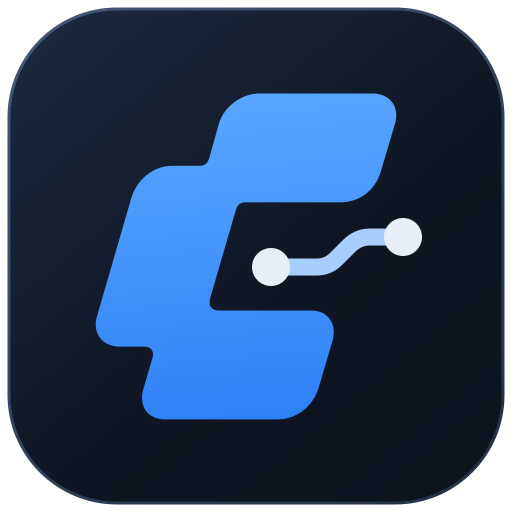

# ComfyUI Remote Manager



ComfyUI Remote Manager is a Windows desktop app for running and managing ComfyUI Portable on another computer. The **PC Server** hosts ComfyUI; the **PC Client** runs this app. They connect through Tailscale and SSH. Starting ComfyUI also starts a Cloudflare Quick Tunnel and displays its public link in the app.

Both installers and the app support English and Italian. Each installer asks for a language before setup begins, with English selected by default. The PC Client installer sets the app's initial language to your selection. In the app, change **Language** in the left sidebar; the choice is saved immediately for future launches. When running the app directly without an installer or saved preference, English is the default.

## Choose an installation method

Both options use the same guided setup. Set up **PC Server** first, then **PC Client**. Setup requires Windows x64, an internet connection and WinGet (Microsoft App Installer).

### Option 1: Run from source

1. [Download the repository ZIP](https://github.com/raffaele-pet/Comfyui-Remote-Manager/archive/refs/heads/main.zip) and extract it, or clone the repository:

   ```sh
   git clone https://github.com/raffaele-pet/Comfyui-Remote-Manager.git
   ```

2. On PC Server, open `install-server.bat`. On PC Client, open `install-client.bat` from its own copy of the source folder.
3. On PC Client, open `run.bat` or the Desktop shortcut. The app runs from `app/` in the source folder. Setup prepares Python and the local `.venv` as needed; no build is required.

### Option 2: Use the Windows installers

Download the installers from [GitHub Releases → Assets](https://github.com/raffaele-pet/Comfyui-Remote-Manager/releases/latest):

- **PC Server:** [install-server.exe](https://github.com/raffaele-pet/Comfyui-Remote-Manager/releases/latest/download/install-server.exe)
- **PC Client:** [install-client.exe](https://github.com/raffaele-pet/Comfyui-Remote-Manager/releases/latest/download/install-client.exe)

Open each installer on its corresponding PC. After setup, launch **ComfyUI Remote Manager** from the PC Client Desktop shortcut.

## Demo


An illustrated 30-second walkthrough of setup and remote use. Icons by [Lucide](https://lucide.dev/) ([license](./assets/demo/LUCIDE-LICENSE.txt)).

## Set up PC Server

Install ComfyUI Windows Portable and use a Windows account with a password for SSH.

1. Open the installer, approve the administrator prompt, and select the ComfyUI folder, startup batch file and SSH user.
2. Sign in to Tailscale, verify Cloudflare and save `comfyui-remote-config.json`. Copy it to PC Client. The file contains connection settings and paths but no password.

## Set up PC Client

1. Run the installer and sign in to the same Tailscale network as PC Server.
2. Import the configuration file or enter the settings manually. Open the app, enter the SSH password and connect.

## Features

- **Remote control:** Check, start, stop and update ComfyUI. Open its public Cloudflare link in the browser.
- **Files:** Browse PC Server over SFTP, manage files and models, edit text, or download from a URL directly to PC Server.
- **Terminal:** Use PowerShell over SSH with the active Windows keyboard layout on PC Client.
- **Change folder or user:** Edit **ComfyUI Portable folder** and **Startup batch file** as needed, then select **Save folder and batch file**. If the Windows account changes, update **User** and reconnect.
- **Local settings:** Connection details and language are saved on PC Client. Remembered SSH passwords are protected with Windows encryption.

Cloudflare Quick Tunnel links are public. Use them only for content you intend to expose.

## Start ComfyUI locally after using it remotely

PC Server setup adds [`run_nvidia_gpu_close_instances.bat`](./launchers/run_nvidia_gpu_close_instances.bat) next to `run_nvidia_gpu.bat`. Run it on PC Server to close existing ComfyUI instances, check that port 8188 is free and start a new session in the browser. Closing an instance interrupts any jobs it is running.
