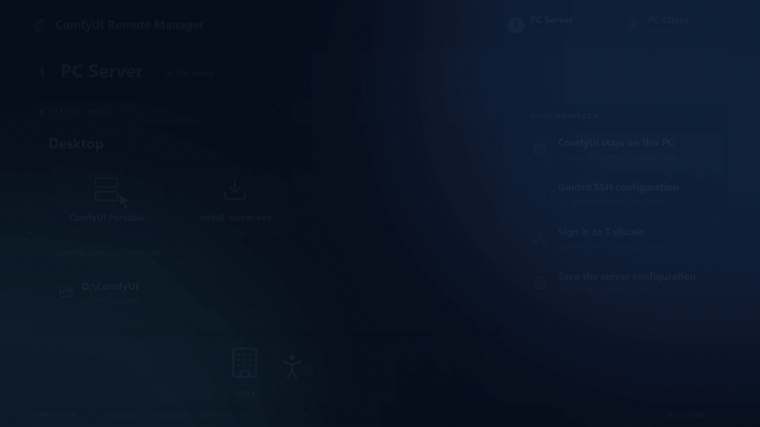

# ComfyUI Remote Manager

ComfyUI Remote Manager is a Windows desktop app for running and managing ComfyUI Portable on another computer. The **PC Server** hosts ComfyUI; the **PC Client** runs this app. They connect through Tailscale and SSH. Starting ComfyUI also starts a Cloudflare Quick Tunnel and displays its public link in the app.

Both installers and the app support English and Italian. Each installer asks for a language before setup begins, with English selected by default. The PC Client installer sets the app's initial language to your selection. In the app, change **Language** in the left sidebar; the choice is saved immediately for future launches. When running the app directly without an installer or saved preference, English is the default.

## Choose an installation method

Both options use the same guided setup. Set up **PC Server** first, then **PC Client**. Setup requires Windows x64, an internet connection and WinGet (Microsoft App Installer).

### Option 1: Run from source

1. [Download the repository ZIP](https://github.com/raffaele-pet/Comfyui-Remote-Manager/archive/refs/heads/main.zip) and extract it, or clone the repository:

   ```sh
   git clone https://github.com/raffaele-pet/Comfyui-Remote-Manager.git
   ```

2. On PC Server, open `install-server.bat`. On PC Client, open `install-client.bat` from its own copy of the source folder.
3. On PC Client, open `run.bat` or the Desktop shortcut. The app runs from `app/` in the source folder. Setup prepares Python and the local `.venv` as needed; no build is required.

### Option 2: Use the Windows installers

Download the installers from [GitHub Releases → Assets](https://github.com/raffaele-pet/Comfyui-Remote-Manager/releases/latest):

- **PC Server:** [install-server.exe](https://github.com/raffaele-pet/Comfyui-Remote-Manager/releases/latest/download/install-server.exe)
- **PC Client:** [install-client.exe](https://github.com/raffaele-pet/Comfyui-Remote-Manager/releases/latest/download/install-client.exe)

Open each installer on its corresponding PC. After setup, launch **ComfyUI Remote Manager** from the PC Client Desktop shortcut.

## Demo



An illustrated 30-second walkthrough of setup and remote use. Icons by [Lucide](https://lucide.dev/) ([license](./assets/demo/LUCIDE-LICENSE.txt)).

## Set up PC Server

The PC Server needs the Windows portable edition of ComfyUI, with a `run*.bat` launcher and `python_embeded\python.exe` in its main folder. The Windows account used for SSH must have a password; a Windows Hello PIN is not sufficient.

1. Open the PC Server installer for your chosen method and approve the Windows administrator prompt.
2. Choose a language, the ComfyUI Portable folder, a startup batch file, and the Windows account to use for SSH. The installer prepares OpenSSH Server, Tailscale, and `cloudflared`.
3. Open Tailscale from the installer, sign in, and verify the connection. Use the same tailnet on both computers. If unattended mode cannot be enabled automatically, enable it in Tailscale's settings.
4. Verify `cloudflared`. The installer adds `run_nvidia_gpu_close_instances.bat` to the selected ComfyUI Portable folder and explains how to use it. Save `comfyui-remote-config.json` and copy it to the PC Client. The file contains connection settings and paths, but no password.

## Set up PC Client

1. Open the PC Client installer for your chosen method.
2. Choose a language and start the installation. The installer prepares Tailscale and the Python environment and creates a Desktop shortcut.
3. Sign in to Tailscale with the same tailnet as the PC Server, then verify the connection.
4. Import the configuration file from the PC Server, enter its settings manually, or close the installer and enter them in the app. Enter the SSH password in the app.

To update PC Client, update your source copy and run `install-client.bat`, or run the latest `install-client.exe` if you installed from Releases.

Installation folders are discovered from the current computer's Windows known folders. The installers contain no personal usernames, addresses, connection profiles, or saved installation paths. PC Server folders come from the selected ComfyUI location and the connected server's Windows profile, including a redirected Desktop. Saved settings belong to the current user's local installation and are not included in the installers.

The PC Client installer tests Python before using it and creates the environment with the validated interpreter directly. Broken launcher registrations are ignored; an unusable app environment is recreated. `run.bat` uses the app's relative environment location and ignores external Python environment variables.

## Change the ComfyUI folder or Windows user

If ComfyUI is moved or renamed on the PC Server, update **ComfyUI Portable folder** and, if needed, **Startup batch file** in the PC Client app. Select **Save folder and batch file**. The new path is used for start, stop, update, remote file shortcuts, and direct URL downloads. If the PC Server's Windows user changes, update **User** and reconnect.

**Save folder and batch file** is disabled when the saved folder and batch file are already current. It becomes available when they are missing, changed, or imported from a new configuration file.

The connection profile is stored on the PC Client at `%LOCALAPPDATA%\ComfyUIRemoteManager\connection.json`. Language preference is stored separately at `%LOCALAPPDATA%\ComfyUIRemoteManager\preferences.json`. Saving the SSH password is optional; when enabled, it is protected with Windows encryption. The app does not create report, link, or download configuration files on the PC Server Desktop.

## Features

- Check, start, stop, and update ComfyUI remotely.
- Start Cloudflare and display the public link in the app.
- Browse files over SFTP; upload, download, preview, rename, move, and delete them.
- Download a URL directly on the PC Server without installing a persistent helper there.
- Use an SSH PowerShell terminal and edit remote text files. The terminal follows the active Windows keyboard layout on PC Client, independently of the app language. It shows the prompt and typing directly in the console, starting at the top, with cursor movement and scrollback. Press Enter to run a command and Ctrl+C to interrupt it; Ctrl+C copies text when a selection is active.

**PC Server shortcuts** has two rows: User home, Desktop, and Recycle Bin; then ComfyUI Portable, custom nodes, models, diffusion models, text encoders, vae, and loras. The sidebar groups connection settings, ComfyUI settings, and language selection. Open the terminal from the file browser toolbar. The names **PC Server** and **PC Client** stay the same in both languages.

## Start ComfyUI locally after using it remotely

The PC Server installer automatically adds [run_nvidia_gpu_close_instances.bat](./launchers/run_nvidia_gpu_close_instances.bat) alongside `run_nvidia_gpu.bat` in the selected ComfyUI Portable folder. You can also download it separately. Use this additional launcher to close previous ComfyUI instances, verify that port 8188 is free, and then start ComfyUI with `--windows-standalone-build --listen 0.0.0.0 --enable-manager --enable-manager-legacy-ui`. Closing an instance interrupts its running jobs.

The launcher uses its own folder, so moving or renaming ComfyUI Portable does not require editing the batch file. A local launch opens `http://127.0.0.1:8188` in the default browser when ComfyUI is ready, including when cleanup needs administrator permission. Over SSH, the browser stays closed on the PC Server. It needs no separate cleanup script or Desktop log files. When closing an instance requires administrator permission, a local launch asks for it. Over SSH, a permission error stops startup and appears in the app. If another application owns port 8188, the launcher reports it and stops. To use this additional launcher from the app, set **Startup batch file** to `run_nvidia_gpu_close_instances.bat` and save it.

The temporary `trycloudflare.com` link is public. [Cloudflare describes Quick Tunnels as suitable for testing and development](https://developers.cloudflare.com/cloudflare-one/networks/connectors/cloudflare-tunnel/do-more-with-tunnels/trycloudflare/); do not use the link for data that must stay private.

## Project layout

| Path | Contents |
| --- | --- |
| [`app/`](./app) | PC Client application, dependencies and translations |
| [`installer/`](./installer) | Guided setup and Windows bootstrap |
| [`launchers/`](./launchers) | Local ComfyUI launcher for PC Server |
| [`tools/`](./tools) | Windows installer build script |
| [`assets/`](./assets) | Desktop icon and demo |

To build the Windows installers, install PyInstaller on Windows and run `python tools/build_installers.py`. The output is written to `dist/`. Version tags publish the installers to GitHub Releases.

Desktop shortcut icon: [Icons8](https://icons8.it/icon/rJGwKUDZzg4L/ai).
